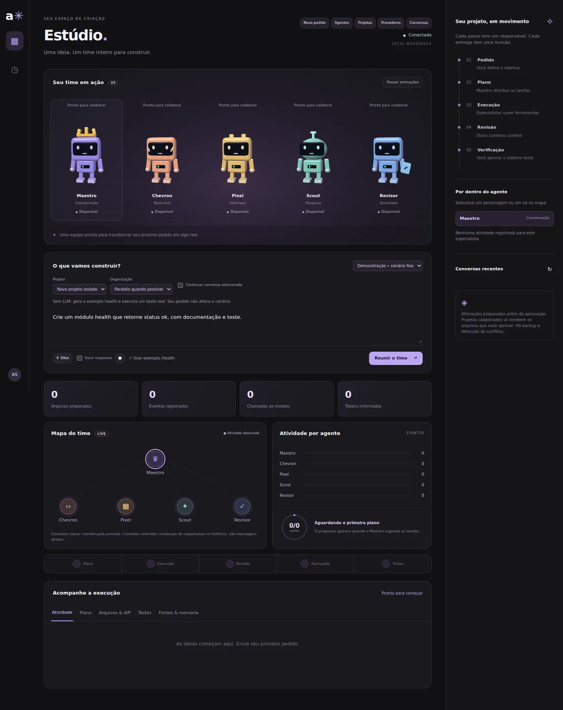

# Agent Studio ✳

Estúdio multiagente inspirado no [post de Fernando Nogueira](https://www.linkedin.com/feed/update/urn:li:activity:7521330422434246656/), implementado para a atividade **REA is back**. Um pedido reúne especialistas, produz propostas, gera um plano, executa tarefas, revisa o código e pede sua decisão sobre os arquivos e comandos.

## Interface verificada

Capturas reais do teste de navegador, com cinco personagens WebGL. O cenário mostrado é a demonstração fixa, identificada na própria interface.



[Execução concluída e gráficos](docs/screenshots/full/desktop.webp) · [Interface no celular](docs/screenshots/full/mobile.webp)

## Começar

**Node.js 22.12+**. O servidor web não precisa de bibliotecas npm em produção.

```sh
git clone https://github.com/SergioPacheco/agent-studio.git
cd agent-studio
cp .env.example .env
npm start
```

Abra **http://127.0.0.1:5173**. O demo não precisa de credenciais: gera um projeto health fixo e executa um teste real. O demo **não interpreta pedidos livres nem chama modelos**. Seus estados e gráficos descrevem esse cenário programado, claramente identificado.

## Usar assinaturas existentes: Claude + Codex + Gemini

A configuração inicial escolhe **Claude Code CLI** para Maestro, Chevron e Pixel; **Gemini CLI** para Scout; **Codex CLI** para Revisor. Instale e autentique as ferramentas oficiais no seu terminal. A aplicação não pede, copia ou gerencia suas senhas de login.

- [Claude Code: configuração e autenticação](https://code.claude.com/docs/en/setup)
- [Codex CLI](https://github.com/openai/codex)
- [Gemini CLI](https://github.com/google-gemini/gemini-cli)

No painel **Provedores**, confira a detecção; em **Agentes**, escolha provedor e modelo de cada especialista. Campo de modelo vazio usa o padrão da CLI. Use versões recentes: os adaptadores dependem dos modos headless estruturados e dos controles de ferramentas documentados. A presença de um executável **não comprova login, saldo, quota ou direito de uso pela assinatura**. Faça uma chamada pequena para verificar sua conta.

As CLIs são chamadas por processo, com argumentos separados, entrada por stdin, contexto de conversa próprio e diretório temporário neutro. Ferramentas nativas/MCP são desabilitadas ou restringidas; o modelo solicita as ferramentas da aplicação por um envelope JSON. O aplicativo executa apenas ferramentas autorizadas para aquele agente. Sem `--yolo`, sem bypass de sandbox e sem autenticação automatizada. Codex usa modo read-only e ignora configurações de projeto/usuário; Gemini recebe um arquivo de configurações com allowlist vazia de ferramentas e MCP. Versões incompatíveis falham com erro visível; não há fallback silencioso para API paga.

Variáveis de chaves dos provedores são esvaziadas nos subprocessos CLI para evitar selecionar acidentalmente cobrança por API. Os logins existentes das próprias ferramentas continuam sob responsabilidade delas. Limites e políticas da assinatura são os do fornecedor. Em Windows, prefira WSL ou configure `STUDIO_*_CLI` para um executável nativo real; shims `.cmd` não são invocados por shell.

### APIs opcionais e múltiplos provedores

Além das três CLIs, há adaptadores de **Chat Completions compatível OpenAI, Anthropic Messages e Gemini generateContent**. Crie o provedor no painel, com URL base e **nome** da variável da chave; defina seu valor no `.env` do servidor e reinicie. Nenhuma chave é retornada à interface ou gravada no catálogo.

Exemplos de URLs base: `https://api.openai.com/v1`, `https://api.anthropic.com/v1`, `https://generativelanguage.googleapis.com/v1beta`. Selecione o modelo real disponível na sua conta. Um time pode misturar CLIs e APIs. Definir `AI_API_KEY` e `AI_MODEL` no primeiro início cria um provedor legado e associa os cinco agentes a ele, por compatibilidade com a versão inicial. Depois do primeiro início o catálogo salvo prevalece.

## Funcionalidades do post

| Funcionalidade | Implementação |
| --- | --- |
| Mascotes com função e personalidade | Modelos **3D reais em WebGL**, gerados por código, com perspectiva, iluminação, juntas e expressões; cor e forma editáveis. SVG identificado como fallback se WebGL faltar. |
| Um pedido para o time | Campo principal; Maestro recebe objetivo, memória aprovada e contexto da conversa selecionada. |
| Planejamento adaptativo | O coordenador seleciona a arquitetura e distribui tarefas conforme dependências e permissões. |
| Sequência ou paralelo | Plano com dependências e reservas de arquivos; scheduler até três tarefas independentes em paralelo, ou modo sequencial. |
| Trabalho nas pastas dos projetos | Cadastro de pasta existente, leitura do snapshot, alterações preparadas, aplicação dos arquivos selecionados na pasta original, backup e detecção de conflitos. |
| Aprovação de comandos sensíveis | Cartão com comando/argumentos, motivo, imagem e escopo. Só a decisão explícita libera execução; comandos propostos rodam em snapshot Docker isolado. |
| Revisão linha por linha | Diff com linhas removidas/adicionadas, arquivos novos/excluídos, seleção por arquivo e revisão em contexto separado com ferramenta somente leitura. |
| Criar e editar agentes no painel | Nome, papel, função, instruções, personalidade, provedor, modelo, cor, mascote e permissões; até 12 agentes. |
| Uso de assinaturas | Adaptadores oficiais de CLI; APIs opcionais, nunca usadas como fallback oculto. |
| Pesquisa com fontes | Scout pode pesquisar na web e ler URLs públicas; fontes e trechos aparecem no painel. Falhas são exibidas, sem evidência inventada. |
| Aplicação desktop | Electron com servidor local próprio, isolamento de contexto e seleção nativa de pastas. |
| Voz | Ditado nativo do navegador ou transcrição local Whisper; leitura de respostas por síntese de voz do sistema. |
| Histórico e conversas separadas | Conversas persistentes por agente/projeto, histórico de execuções e continuação da conversa de equipe selecionada. |
| Memória do projeto | Regras/notas editáveis; sugestões do agente precisam de aprovação antes de virar memória persistente. Não treina o modelo. |
| Plano aprovado antes de alterar arquivos | Aprovação do plano antes da execução e do diff antes de modificar a pasta original. |
| Testes ao final | O sistema testa os arquivos aprovados; falhas podem voltar para correção/revisão, com limite de duas tentativas. |
| Commit e deploy automático | Commit dos arquivos aplicados, push opcional explícito e workflow de deploy à VPS após CI aprovado. Ativação depende da configuração da sua VPS. |

## Projetos existentes

Abra **Projetos**, informe nome/pasta e configure o comando de testes como uma lista JSON, por exemplo `["npm","test"]`, `["mvn","test"]` ou `["node","--test"]`. No desktop há seletor nativo de pasta. Escolha o projeto no pedido principal e use o modo IA; o demo é sempre isolado para não sobrescrever seu projeto com o fixture.

O modelo recebe a lista de arquivos e lê conteúdos por ferramenta. São aceitos arquivos fonte/texto, até 100 KB por arquivo, 250 arquivos e 4 MB por snapshot. Diretórios de dependências/build, links simbólicos, `.env` e nomes comuns de arquivos de credenciais não são enviados. A tela registra arquivos ignorados; selecionar uma subpasta ajuda em repositórios maiores. Isso não é um detector universal de segredos: escolha somente projetos e arquivos que possam ser enviados aos provedores configurados.

Tarefas com dependências, mesmo agente ou reservas de arquivos em comum são serializadas. Tarefas independentes podem trabalhar em paralelo. Alterações sem reservas usam controle otimista de conflitos: uma escrita concorrente incompatível interrompe o trabalho, em vez de substituir silenciosamente o resultado anterior. Cada tarefa tem histórico próprio; o revisor recebe objetivo, diff e acesso somente leitura aos arquivos.

Ao aprovar o diff, o sistema confere se o projeto mudou desde a leitura. Aplica somente os arquivos escolhidos, salva backup e testa. Rejeitar um arquivo pode invalidar o conjunto: os testes mostram o resultado efetivo da seleção. **Restaurar último backup** também verifica alterações externas antes de restaurar; restaura arquivos de trabalho, sem apagar commits ou reescrever o histórico Git.

### Testes e comandos

Por padrão os testes de código gerado e os comandos propostos rodam em Docker:

```sh
docker pull node:22-alpine
```

Escolha uma imagem adequada em Projetos para outras stacks. A imagem precisa já existir; não é baixada automaticamente durante a execução. O container fica sem rede, sem capacidades, com filesystem somente leitura, pasta montada somente leitura e limites de CPU/memória/processos/tempo. Dependências precisam estar na imagem; não há instalação de pacotes pela rede nesse ambiente. Não equivale a uma VM.

Projetos existentes também podem usar **testes na pasta original**, com suas dependências locais. A aprovação informa o comando e exige confirmação específica desse modo. Ele executa código do projeto com os privilégios do usuário; comandos de ferramentas propostos pelo modelo continuam isolados em Docker. As variáveis de ambiente com nomes comuns de credenciais são esvaziadas nos processos de testes no host. Testes aprovados não demonstram ausência de todos os bugs.

Se um teste falhar, use **Corrigir falhas e revisar**: o executor recebe a saída real, passa novamente pelo revisor e aguarda nova aprovação do diff. Até duas correções de testes, além do limite de duas correções por rodada de revisão.

### Git

Após testes aprovados em projeto existente, **Criar commit / push** pede mensagem e decisão explícita sobre push. Inclui somente os arquivos aplicados pelo estúdio; arquivos de terceiros já staged são preservados fora do commit. Hooks Git podem rodar e a autenticação de push continua sendo a do seu Git. O push pode ativar o deploy do próprio repositório.

## Pesquisa

Sem chave de pesquisa, o servidor tenta resultados HTML públicos do DuckDuckGo. Sites podem negar requisições ou alterar o formato; nesses casos o erro aparece e o agente pode pedir uma URL. `BRAVE_SEARCH_API_KEY` habilita opcionalmente Brave Search. Leituras usam HTTP/HTTPS público com resolução DNS validada e conexão fixada ao endereço, bloqueio de redes internas/reservadas, redirecionamentos limitados, timeout e limite de conteúdo. Apenas IPv4 público é suportado.

Páginas são texto de referência não confiável; não viram instruções de sistema. URLs, títulos e trechos ficam em **Fontes & memória**. A aplicação não inventa fontes quando a pesquisa falha.

## Voz

**Ditar** só começa após clique e permissão de microfone. O texto transcrito fica no campo para você revisar; não envia o pedido automaticamente. Navegadores com SpeechRecognition podem usar serviços de reconhecimento do fornecedor do navegador. **Ouvir respostas** usa a síntese de voz disponível no sistema; há controle para interromper.

Para transcrição local em navegadores/Electron sem reconhecimento nativo, instale [Whisper](https://github.com/openai/whisper) e FFmpeg e configure:

```dotenv
STUDIO_STT_COMMAND=["whisper"]
STUDIO_STT_MODEL=base
```

O servidor grava um áudio temporário, chama a CLI, lê seu JSON e remove os arquivos temporários. Modelos Whisper precisam estar disponíveis localmente. Sem mecanismo de reconhecimento disponível, o ditado fica desabilitado com explicação. Microfone e qualidade de voz dependem dos dispositivos/permissões; fixtures automatizados não substituem esse teste físico.

## Desktop

```sh
npm ci
npm run desktop
```

A janela Electron inicia um servidor em porta local livre e usa token interno que não é exposto ao renderer. Node integration desligado, context isolation e sandbox do renderer ligados. O preload expõe apenas seleção de pasta. A pasta de dados fica em `app.getPath('userData')/workspace`; `.env` pode ser colocado em `userData/.env` para o app instalado. No desenvolvimento, `.env` da raiz também é lido.

Para gerar AppImage Linux:

```sh
npm run desktop:pack
```

O workflow manual **Build desktop application** também gera o instalador. O CI principal faz smoke test abrindo a janela com cinco agentes. Em Linux, o helper de sandbox do Chromium precisa da configuração exigida pelo Electron; o CI configura o helper oficial com proprietário root e modo 4755, sem desabilitar o sandbox. O servidor web continua podendo rodar sem instalar Electron. Em sistemas sem aceleração gráfica o fallback SVG é identificado.

## Deploy automático à VPS

O workflow **Deploy verified commit to VPS** espera o workflow **Verify Agent Studio** terminar com sucesso em um push à main. Para ativar:

1. Prepare VPS Linux com Node.js 22.12+, Git/rsync e uma conta sem privilégios administrativos para a aplicação.
2. Instale uma primeira cópia em uma subpasta de `/home/SEU_USUARIO/`, crie `.env` e execute `node scripts/install-service.mjs`; siga os comandos de systemd exibidos. Habilite linger para o usuário se precisar manter o serviço após logout.
3. Configure os secrets do repositório: `VPS_HOST`, `VPS_USER`, `VPS_PATH`, `VPS_SSH_KEY`, `VPS_KNOWN_HOSTS` (chave do host verificada fora do pipeline).
4. Defina a variável de repositório `VPS_DEPLOY_ENABLED=true` e configure o environment `production` conforme sua política.

O pipeline transfere o commit exato aprovado pelo CI e reinicia o serviço de usuário. `.env`, `.studio`, `.git` e `node_modules` são preservados/excluídos da sincronização. Chaves de host são verificadas; não há desativação da verificação SSH.

O servidor permanece em loopback. Acesso por túnel SSH funciona sem exposição pública. Para proxy HTTPS público, defina `STUDIO_PUBLIC_ORIGIN` e um `STUDIO_AUTH_TOKEN` longo e aleatório: a interface exige login pelo token, usa cookie HttpOnly/SameSite e limita tentativas. Sem token a configuração pública é recusada. O app é de usuário único, não um serviço multi-tenant.

**Nenhuma VPS real é criada ou acessada pelo código sem essa configuração.** Os secrets e a autenticação de fornecedores são seus; não os coloque no código nem envie por chat.

## Verificação e limites de evidência

```sh
npm run check
npm test
```

Testes cobrem aplicação/restauração seletiva, conflitos, symlinks, memória, conversas separadas, commit sem incluir staged de terceiros, protocolos de três CLIs e três APIs, permissões, paralelismo, voz local por fixture e bloqueio de URLs internas. No CI também há Docker real, aprovação de comando, fluxo no Chromium/WebGL, criação de agente, layout móvel, movimento reduzido e smoke test Electron.

Os provedores de IA e a transcrição usam fixtures nos testes automatizados; não há consumo de contas pagas. **Protocolos testados não significam autenticação real verificada.** Login e limites das suas CLIs, microfone/voz, pesquisa ao vivo e deploy da sua VPS precisam de validação no ambiente configurado. O erro real fica visível quando um desses serviços não está disponível.

Execuções, catálogo, memória e conversas são JSON com escrita temporária/rename em `.studio`. Reinício durante trabalho marca a execução como interrompida; não repete comandos automaticamente. Não há recuperação automática de efeitos externos incertos. Os logs contêm objetivos, código e saídas autorizadas: mantenha a pasta de dados privada.

## Referências

- [Post original](https://www.linkedin.com/feed/update/urn:li:activity:7521330422434246656/)
- [Claude CLI reference](https://code.claude.com/docs/en/cli-reference)
- [Codex source and documentation](https://github.com/openai/codex)
- [Gemini headless](https://geminicli.com/docs/cli/headless/)
- [OpenDots](https://github.com/CopilotKit/OpenDots) e [Pixel Agents](https://github.com/pixel-agents-hq/pixel-agents): inspiração conceitual; sem cópia de código ou assets.

Código e modelos visuais originais. Licença MIT.

## Casos da aula e arquiteturas adaptativas

O seletor **Casos da aula** carrega seis objetivos editáveis: triagem (esteira), auditoria (supervisor), reserva de salas (hierárquica), plano de aula (esteira), armazenamento (rede) e mensagem de erro (agente único). A referência didática e o critério de validação aparecem sem consumir IA. A seleção não executa auditorias nem inventa resultados. O modo demo continua sendo exclusivamente health.

Em **IA conectada**, o planejador escolhe e justifica a arquitetura a partir do pedido editado; a aba Plano apresenta escolha, juiz, tarefas e contratos. A aprovação humana continua obrigatória. Portões retornam veredito estruturado: uma reprovação interrompe a execução antes de liberar dependentes. Relatórios possuem verificação estrutural própria, claramente distinta de testes de código; JSON de relatório fica em `reports/`. O limite passa a 32 tarefas por plano, sem aumentar permissões ou limites de snapshot. Etapas dependentes recebem os resultados textuais anteriores, além dos arquivos preparados.

- Agente único: tarefas de um executor, serializadas. O revisor independente existente continua como portão de qualidade.
- Esteira: dependência e passagem de resultado entre etapas, execução serial.
- Supervisor: tarefas independentes em paralelo conforme os limites existentes, dependências explícitas para consolidação.
- Hierárquica: coordenação representada por tarefas de domínio, validação de cada frente e integração dependente das validações. Não cria agentes recursivamente.
- Rede: propostas/críticas em 1–3 rodadas; cada rodada depende de todas as tarefas anteriores; revisor externo recebe o registro completo.

São casos de planejamento, não seis aplicações prontas. Para executar trabalho real, forneça os arquivos e requisitos e configure provedores. O projeto ainda utiliza um snapshot por execução: auditoria multi-repositório requer disponibilizar os arquivos dentro dos limites existentes. Testes automáticos de integração usam provedores simulados; não demonstram qualidade das escolhas de um modelo real.

## Palco adaptativo e acompanhamento

O palco organiza os personagens 3D conforme a arquitetura do plano. Exibe justificativa, critério de validação e etapas; agentes de apoio ficam identificados. Hierarquia mostra frentes de tarefas, sem inventar subagentes. As conexões vêm das dependências explícitas, distribuição e revisão previstas. Animação indica entrada disponível para uma tarefa em execução, não prova de uma mensagem entre modelos. Eventos consecutivos do histórico não geram conexões.

O seletor dos seis casos oferece prévias visuais sem chamadas a modelos, claramente marcadas. Clique num personagem para inspecionar tarefas, contratos e resultados. Planejamento, execução, validação, revisão, espera, bloqueio e conclusão possuem indicadores distintos; movimento reduzido e pausa são respeitados. Em telas pequenas, somente o palco permite rolagem horizontal.

A organização espacial, os estados visíveis e a inspeção foram inspirados na [Muvuca](https://github.com/Silly-Machine/muvuca). O código do palco e os personagens 3D são próprios; não foram copiados os personagens ou assets da referência.

## Galeria dos seis casos

Na abertura, os seis casos aparecem simultaneamente em cartões acima do palco. Cada cartão inclui a identificação do caso, arquitetura recomendada para o enunciado, diagrama conceitual, justificativa e critério de validação. **Explorar caso** abre a prévia correspondente no palco sem chamar modelos. Em telas pequenas, os cartões são empilhados; não é necessário abrir o seletor para descobrir os casos.
